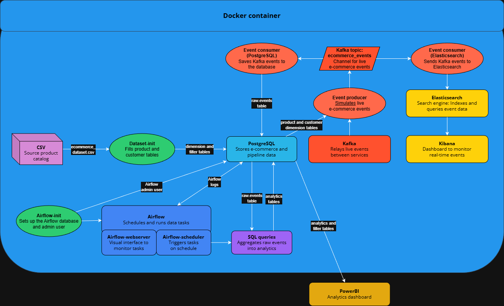

# Streaming ETL Pipeline for E-Commerce Analytics

[](https://www.docker.com)
[](https://www.postgresql.org)
[](https://kafka.apache.org)
[](https://airflow.apache.org)
[](https://www.elastic.co/elasticsearch)
[](https://www.elastic.co/kibana)
[](https://www.microsoft.com/en-us/power-platform/products/power-bi)
[](https://www.python.org)



This repository contains a fully containerized streaming ETL pipeline built on a synthetic e-commerce dataset.

Raw CSV data is ingested and used to fill product and customer dimension tables.

From there, an event producer continuously generates realistic e-commerce events at high frequency, which are consumed in parallel by two services: one persists events to PostgreSQL, where Airflow triggers aggregation queries every 5 minutes to build analytics tables; the other streams events to Elasticsearch, making them available for real-time monitoring in a Kibana dashboard.

A [Power BI dashboard](https://emile-muller.alwaysdata.net/streaming-etl/) sits on top of the PostgreSQL analytics layer for reporting.

---

## Overview

- Overview of this project: [click here](https://emile-muller.alwaysdata.net/streaming-etl/)

---

## Prerequisites

### General

- Docker and Docker Compose installed

### Download the CSV

Download the raw CSV dataset [here](https://www.kaggle.com/datasets/darwish1337/ecommerce), make sure to name it `ecommerce_dataset.csv`, and add it to the `data` folder.

### Kafka Cluster ID

Kafka requires a unique cluster ID to function.

On Linux and macOS, run the `setup.sh` script to generate a Kafka cluster ID automatically.

On Windows, you'll need Git Bash (`Git Bash Here` option in the repo folder) or WSL.

```console
chmod +x setup.sh && ./setup.sh
```

Or manually:

```
# At the root of the project

# 1. Copy the example env file
cp .env.example .env

# 2. Generate a Kafka cluster ID and paste it in
docker run --rm confluentinc/cp-kafka:7.5.3 kafka-storage random-uuid

# 3. Open .env and set KAFKA_CLUSTER_ID=<the_generated_uuid>
```

---

## Project Structure

```
.
|   .dockerignore
|   .env	# Environment file (not tracked by git)
|   .gitignore
|   compose.yaml
|   Dockerfile.airflow
|   Dockerfile.bootstrap
|   Dockerfile.consumer.elasticsearch
|   Dockerfile.consumer.postgresql
|   Dockerfile.producer
|   README.md
|   setup.sh
|
+---dags	# Airflow DAGs (one per analytics table)
|   |   dag_conversion_funnel.py
|   |   dag_discount_sales.py
|   |   dag_overall_performance.py
|   |   dag_product_dim_performance.py
|   |   dag_product_performance.py
|   |   dag_product_stock_alerts.py
|   |   dag_user_geo_performance .py
|   |   dag_user_performance.py
|   |
|   \---sql	# SQL queries executed by each DAG
|           aggregate_conversion_funnel.sql
|           aggregate_discount_sales.sql
|           aggregate_overall_performance.sql
|           aggregate_product_dim_performance.sql
|           aggregate_product_performance.sql
|           aggregate_product_stock_alerts.sql
|           aggregate_user_geo_performance.sql
|           aggregate_user_performance.sql
|
+---data	# Raw CSV dataset (not tracked by git)
|       ecommerce_dataset.csv
|
+---docs	# Architecture diagram
|       data_pipeline.png
|
+---postgres-init	# SQL scripts run on first PostgreSQL startup
|       01-init.sql
|       02-ecommerce.sql
|
+---requirements	# Python dependencies (one file per service)
|       bootstrap.txt
|       consumer_elasticsearch.txt
|       consumer_postgresql.txt
|       producer.txt
|
+---scripts	# Bootstrap scripts run once at startup
|       bootstrap.py
|       generate_product_datatables.py
|       generate_user_datatables.py
|
\---services	# Long-running Python services (producer & consumers)
        event_consumer_to_elasticsearch.py
        event_consumer_to_postgresql.py
        event_producer.py
        session_generator.py
```

---

## Run the data pipeline

### Memory usage

The full stack runs entirely locally and can use up to 8GB RAM. To keep resource usage manageable, two Docker Compose profiles are available, running both simultaneously is not recommended.

- `airflow`: PostgreSQL, Kafka, Airflow (analytics pipeline feeding the Power BI dashboard)
- `elastic`: PostgreSQL, Kafka, Elasticsearch, Kibana (real-time event monitoring)

Once running, services are accessible at:
- Airflow webserver: http://localhost:8080/
- Elasticsearch: http://localhost:9200/_cluster/health
- Kibana: http://localhost:5601/app/home

If you are on Windows, you can limit the memory Docker is allowed to use by creating a   `.wslconfig` file in your Windows user folder (`C:\Users\<YourUsername>\.wslconfig`):
```
[wsl2]
memory=8GB
processors=4
swap=2GB
```

Then restart WSL for the changes to take effect:
```
wsl --shutdown
```

### Airflow profile

#### Start the services

```
docker compose --profile airflow up -d
```

#### Stop the process

```
docker compose --profile airflow down
```

### Elasticsearch profile

#### Start the services

```
docker compose --profile elastic up -d
```

#### Stop the process

```
docker compose --profile elastic down
```

### Both profiles

#### Start the services

```
docker compose --profile airflow --profile elastic up -d
```

#### Stop the process

```
docker compose --profile airflow --profile elastic down
```

## Notes and consideration

- This project uses a single PostgreSQL instance that hosts two databases: one for e-commerce data, one for Airflow's metadata. This reduces memory overhead for local development; in production, these would be separate services for isolation and independent scaling.
- E-commerce events (view, add to cart, remove from cart, purchase) are simulated via `services/event_producer.py` to imitate the high-frequency event stream of a real e-commerce platform.
	- Events are generated using weighted random choices to produce credible distributions. The key factor is the `conversion_score`, a composite metric derived from the product's rating, active discount, price, and review count.
	- Intentional noise is injected into the event stream to simulate real-world data imperfections, including invalid events and out-of-order timestamps.
- All Airflow DAGs run on a 5-minute schedule for demonstration purposes, so results are visible without long waits. In production, each DAG would run on a schedule appropriate to its data, purchase events might aggregate every 5 minutes, while customer-level analytics could run hourly or daily since that data changes more slowly.
- All SQL writes are idempotent. Raw event ingestion uses `ON CONFLICT DO NOTHING` on `event_id`, since a duplicate event should simply be discarded rather than overwrite existing data. Analytics aggregations use `ON CONFLICT DO UPDATE`, since each DAG run recalculates and refreshes the aggregated values for a given time window.